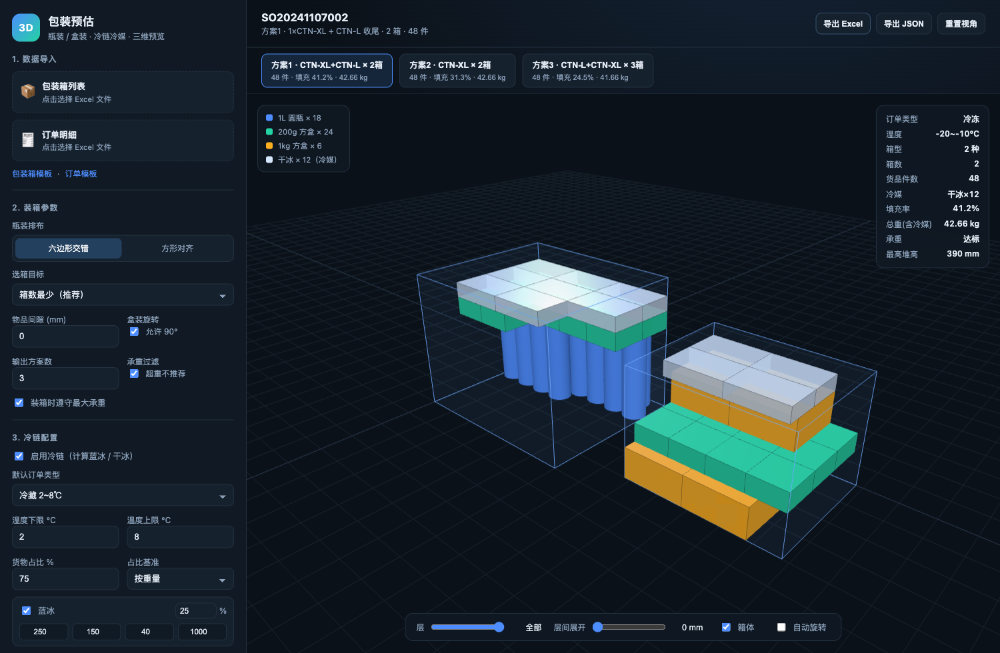

# 包装预估 · 3D 装箱方案

把 **包装箱列表 + 订单明细（Excel）** 变成 **可执行的装箱方案 + 三维预览** 的小系统。

针对的业务规则：

- 一个订单号下有多行货品，先**按 SKU 合并数量**再预估；
- 货品分 **瓶装**（直立圆柱）和 **盒装**（长方体）；
- 圆柱瓶**必须竖着放、不能旋转**；
- 层内**一排紧贴一排**（圆瓶默认六边形交错，最密）；
- **一层一层向上堆叠**，层高一致、顶面尽量平整；
- 方案生成后**直接 3D 预览**，可旋转、缩放、逐层查看。

---

## 1. 快速开始

```bash
pip install -r requirements.txt
python scripts/make_sample_data.py          # 生成示例 Excel（data/boxes.xlsx、data/orders.xlsx）
python -m uvicorn app.main:app --reload --port 8010
```

浏览器打开 <http://127.0.0.1:8010> ，点击 **「加载示例数据」** 即可看到 3D 方案；
也可以上传自己的两个 Excel 后点 **「开始预估」**。

命令行批量跑：

```bash
python -m app.cli --boxes data/boxes.xlsx --orders data/orders.xlsx --out plan.json
```

运行测试：

```bash
pip install -r requirements-dev.txt
python -m pytest tests/ -q
```



> 上图：冷冻订单（-20~-10℃）自动配 12 块干冰，冷媒码在货物上方；顶部可切换方案1/2/3。
>
> 演示动图：[3D 环绕](docs/demo-3d.gif) · [层间展开](docs/demo-explode.gif)

> 三维预览依赖 CDN 上的 Three.js（`cdn.jsdelivr.net`）。若内网无法访问，
> 可把 `three` 下载到 `app/static/vendor/`，再改 `app/static/index.html` 里的 `importmap` 路径。

---

## 2. Excel 格式

列名支持中英文别名自动识别（如 `内长` / `长度` / `length`），数值支持 `400`、`400mm`、`40cm`、`1.2kg` 等写法，
长度统一换算为 **mm**，重量统一为 **g**。

### 2.1 包装箱列表（一个 sheet）

| 箱型编码 | 箱型名称 | 内长(mm) | 内宽(mm) | 内高(mm) | 最大承重(g) | 单价(元) | 箱自重(g) |
| -------- | -------- | -------- | -------- | -------- | ----------- | -------- | --------- |
| CTN-S    | 小号箱   | 250      | 200      | 150      | 6000        | 2.2      | 120       |
| CTN-M    | 中号箱   | 400      | 300      | 250      | 12000       | 3.5      | 220       |
| CTN-L    | 大号箱   | 500      | 400      | 350      | 20000       | 5.8      | 320       |
| CTN-XL   | 超大箱   | 600      | 500      | 450      | 30000       | 8.6      | 450       |

- **内长/内宽/内高** 指箱子内部可用尺寸（必填）；
- **最大承重** 可选，不填视为不限重；
- **单价** 可选，用于「总成本最低」选箱策略。

### 2.2 订单明细（一个 sheet）

| 订单号         | 货品编码 | 数量 | 订单类型 |
| -------------- | -------- | ---- | -------- |
| SO20241107001  | BTL-500  | 24   | 冷藏     |
| SO20241107001  | BTL-500  | 12   | 冷藏     |
| SO20241107001  | BOX-500  | 10   | 冷藏     |

同一订单号 + 同一货品编码的多行会**自动合并数量**（上例合并为 BTL-500 × 36）。

### 2.3 货品档案（同一文件里的第二个 sheet，可选但推荐）

| 货品编码 | 名称       | 类型 | 直径(mm) | 长(mm) | 宽(mm) | 高(mm) | 单重(g) |
| -------- | ---------- | ---- | -------- | ------ | ------ | ------ | ------- |
| BTL-500  | 500ml 圆瓶 | 瓶装 | 65       |        |        | 220    | 550     |
| BOX-500  | 500g 方盒  | 盒装 |          | 160    | 160    | 80     | 520     |

- **瓶装**：填 `直径` + `高`；
- **盒装**：填 `长` + `宽` + `高`；
- 若没有独立档案 sheet，也可以把 `类型/直径/长/宽/高/单重` 直接写在订单明细的每一行里。

页面左下角提供 **包装箱模板** / **订单模板** 下载（`/api/template/cartons`、`/api/template/orders`）。

---

## 3. 算法说明

### 3.0 详细项目文档

模型定义、算法推导、每个函数所在的文件行号、开源项目链接，见 **[docs/PROJECT.md](docs/PROJECT.md)**。

### 3.1 为什么不用现成的通用 3D 装箱库

调研了 GitHub 上几个主流方案：

| 项目 | 能力 | 为什么不适合直接套用 |
| --- | --- | --- |
| [enzoruiz/3dbinpacking (py3dbp)](https://github.com/enzoruiz/3dbinpacking) | Python，长方体装箱，6 种旋转，支持单箱限重，输出 fitted/unfitted | 只支持**长方体**；默认会旋转物品；结果是「塞满」，不保证**直立、成排、逐层** |
| [dwave-examples/3d-bin-packing](https://github.com/dwave-examples/3d-bin-packing) | 基于 CQM 的数学规划，求最少箱数 | 依赖 D-Wave Leap 云服务；不支持圆柱；不输出分层码放方案 |
| [DeepPack3D](https://www.sciencedirect.com/science/article/pii/S2665963824001209) | 深度强化学习 + 构造式启发，在线装箱基准 | 研究向，需训练/调参；物品仍是可旋转长方体，无 UI |
| [three.js](https://github.com/mrdoob/three.js) | WebGL 3D 渲染 | 只负责可视化，采用它作为前端渲染引擎 |

结论：本场景的约束（**圆柱直立不旋转 + 成排 + 逐层**）恰好是通用装箱器的弱项。
通用算法追求「最大填充率」，会把箱子塞成无法人工复现的乱序堆叠；
而仓储/打包真正需要的是**可复现、可分层码放**的方案。

因此核心算法是**自己实现的分层网格装箱**（确定性、无随机数，同一输入永远同一结果）。

### 3.2 分层网格装箱

1. **逐层规划**：从箱底 `z=0` 开始，每次规划一层；
2. **选主 SKU**：在剩余货品里选「单层可放体积最大」的 SKU 作为本层主货品（高件先落底，稳定）；
3. **层内点阵**：
   - 瓶装：默认 **六边形交错**，相邻排横向偏移半个间距、行距 `d·√3/2`，圆柱刚好相切，最密；
     也可切换为**方形对齐**（严格一排对一排）；
   - 盒装：方形点阵，允许水平 90° 旋转取更优铺法（可关闭）；
4. **缝隙回填**：主货品铺不满时，用**更矮**的其他货品通过 MaxRects（最大矩形）回填本层空隙，
   保证层顶面平整、不打乱层高；
5. **层间堆叠**：本层码完，`z += 层高`，继续下一层，直到高度或承重耗尽；
6. **自动换箱**：当前箱装满后开新箱；
7. **选箱**：在所有候选箱型中比较
   - `cartons`（默认）：箱数最少，其次填充率最高；
   - `volume`：总箱容积最小；
   - `cost`：总箱成本最低（需要箱型单价）。

坐标与朝向：箱子内腔 `x∈[0,内长]`、`y∈[0,内宽]`、`z∈[0,内高]`；
物品位置取外接长方体左下后角；瓶装是轴线平行 `z` 的圆柱，**任何情况下都不旋转**。

### 3.3 可调参数

| 参数 | 默认 | 说明 |
| --- | --- | --- |
| 瓶装排布 `pattern` | `hex` | `hex` 六边形交错（更密）/ `square` 方形对齐 |
| 物品间隙 `gap` | `0` | 相邻物品的安全间隙（mm），0 表示紧贴 |
| 盒装旋转 `rotate_box` | `true` | 是否允许盒装水平旋转 90° |
| 遵守承重 `respect_weight` | `true` | 超过箱型最大承重时提前换箱 |
| 选箱目标 `objective` | `cartons` | `cartons` / `volume` / `cost` |

---

## 3.5 冷链规则与 Top3 推荐方案

### 3.5.1 可自定义的规则

页面「冷链配置」区可以改，接口里对应 `config.cold_chain`：

| 配置 | 说明 |
| --- | --- |
| 温度范围 | 订单类型对应的 `temp_min ~ temp_max`（℃） |
| 订单类型 | 常温 / 冷藏 / 冷冻 / 深冷 / 自定义，**每种类型可单独设温度与占比** |
| 是否启用蓝冰 / 干冰 | 勾选即参与计算 |
| 占比 | 货物 / 蓝冰 / 干冰 三者在「总重」或「总体积」中的份额，三者之和为 1 |
| 冷媒规格 | 单块的长宽高（mm）与重量（g），决定占用空间与重量 |
| 占比基准 | 按重量（默认）或按体积 |

**用量公式**：

```
冷媒需求量 = 货物量 × (冷媒占比 ÷ 货物占比)
冷媒块数   = ⌈冷媒需求量 ÷ 单块重量(或体积)⌉      # 向上取整
```

例：货物 70%、蓝冰 20%、干冰 10%，货物 10 kg → 蓝冰 ⌈10×0.2/0.7⌉ = 3 块，干冰 ⌈10×0.1/0.7⌉ = 2 块。

订单如果自带「订单类型」列，会按该类型的规则计算（页面里改过的规则会一起提交，覆盖内置预设）。

### 3.5.2 冷媒怎么放

1. 先码货物，从箱底逐层向上；
2. 按本箱货物重量算出本箱该放的冷媒数量；
3. 冷媒**码在货物上方**（干冰升华向上、蓝冰冷气下沉，顶部更稳）；
4. 如果剩余高度或承重不够，会自动**压低货物可用高度**重排一次，尽量给冷媒留出整层空间。

### 3.5.3 最大承重过滤

- 装箱时给冷媒预留承重：货物可用承重 = `(箱限重 − 箱自重) ÷ (1 + 冷媒/货物重量比)`；
- 每箱最终总重（货物 + 冷媒 + 箱自重）与 `最大承重` 比较，标 `weight_ok`；
- 勾选「承重过滤」后，超重方案排在最后、不会进入推荐 Top3。

### 3.5.4 Top3 方案

每个订单输出最多 3 套方案，来源：

1. 单一箱型装满（按箱数 / 容积 / 成本目标排序）；
2. 「先装一箱 A，余量用 B 收尾」的混装组合；
3. A 装满后 B 继续装的组合；
4. 单箱型装不完时的混装补齐。

去重后按「是否装完 → 冷媒是否放全 → 承重是否达标 → 箱数 → 填充率」排序，取前 3 套。
页面上方「方案1 / 方案2 / 方案3」按钮可切换 3D 预览。

### 3.5.5 导出带推荐列的 Excel

点击页面「导出 Excel」（或命令行 `--export-xlsx`），会在**原订单表右侧**追加三列：

| 订单号 | 货品编码 | 数量 | 订单类型 | 推荐装箱方案1 | 推荐装箱方案2 | 推荐装箱方案3 |
| --- | --- | --- | --- | --- | --- | --- |
| SO20241107001 | BTL-500 | 24 | 冷藏 | CTN-L+CTN-XL×2箱｜填充30.1%｜35.00kg｜承重OK｜蓝冰10块 | … | … |

同时新增一张「装箱方案明细」sheet，列出每个订单 3 套方案的箱型、箱数、填充率、总重、冷媒用量与推荐理由。

## 4. 3D 预览

- 每个订单渲染所有包装箱，箱体用线框 + 半透明面表示；
- 瓶装渲染为**圆柱**，盒装渲染为**长方体**，按 SKU 自动配色；
- 鼠标左键旋转、滚轮缩放、右键平移；
- **层** 滑块：只显示到第 N 层，逐层检查码放顺序；
- **层间展开** 滑块：把各层垂直拉开，查看层与层之间；
- 鼠标悬浮货品显示 SKU、层号、箱号、坐标；
- **冷媒配色**：蓝冰为亮青色、干冰为浅白色半透明块，一眼区分冷媒与货物；
- **方案切换**：顶部「方案1 / 方案2 / 方案3」一键切换不同箱型组合；
- **导出方案 JSON**：包含箱型、每件货品的坐标与层号，可直接给 WMS/打托机使用。

---

## 5. 目录结构

```
packages/
├── app/
│   ├── models.py        # 领域模型：Carton / Item / Placement / 方案
│   ├── packer.py        # 分层网格装箱算法（核心）
│   ├── excel_io.py      # Excel 解析、列名识别、订单合并、模板生成
│   ├── service.py       # 编排：读表 → 合并 → 预估 → 结果字典
│   ├── main.py          # FastAPI 接口
│   ├── cli.py           # 命令行入口
│   └── static/          # Three.js 前端（index.html / app.js / style.css）
├── data/                # 示例 Excel
├── scripts/
│   └── make_sample_data.py
├── tests/
│   └── test_packer.py   # 几何合法性 / 层数 / 合并 / 选箱 等测试
├── docs/
│   └── ALGORITHM.md     # 算法细节与取舍
└── requirements.txt
```

---

## 6. 接口

| 方法 | 路径 | 说明 |
| --- | --- | --- |
| GET | `/` | 3D 预览页面 |
| GET | `/api/health` | 健康检查 |
| POST | `/api/estimate` | 上传两个 Excel（`boxes`、`orders`，可选 `config` JSON）→ 返回全部订单方案 |
| GET | `/api/sample` | 用内置示例数据跑一次 |
| POST | `/api/export` | 上传两个 Excel → 返回**追加了「推荐装箱方案1/2/3」列**的 Excel |
| GET | `/api/sample/export` | 用示例数据导出推荐 Excel |
| GET | `/api/template/cartons` | 下载包装箱模板 |
| GET | `/api/template/orders` | 下载订单模板 |

`/api/estimate` 返回结构（节选）：

```jsonc
{
  "summary": { "order_count": 4, "carton_count": 5, "fill_rate": 0.3905, "unplaced_count": 0 },
  "orders": [{
    "order_no": "SO20241107001",
    "carton_count": 1,
    "fill_rate": 0.346,
    "cartons": [{
      "carton": { "code": "CTN-XL", "length": 600, "width": 500, "height": 450 },
      "layers": [{ "index": 0, "z": 0, "height": 220, "count": 36, "skus": ["BTL-500"] }],
      "placements": [{
        "sku": "BTL-500", "kind": "bottle",
        "x": 0, "y": 0, "z": 0, "w": 65, "l": 65, "h": 220, "d": 65,
        "cx": 32.5, "cy": 32.5, "layer": 0
      }]
    }]
  }]
}
```

---

## 7. 已知限制 & 后续可扩展

- 当前按「同 SKU 成层」为主，层内混装仅在不影响层高时回填；更复杂的混装可引入
  MaxRects/Guillotine 的 3D 版本或 OR-Tools CP-SAT；
- 未建模重心/承压/易碎等物理约束（可加 `fragile`、`max_stack` 字段扩展）；
- 未处理箱内隔板/缓冲材料占位（可通过缩小箱型内径或增加 `gap` 近似）；
- 大批量订单时 `/api/estimate` 会返回全部坐标，数据量较大，可按订单懒加载。
